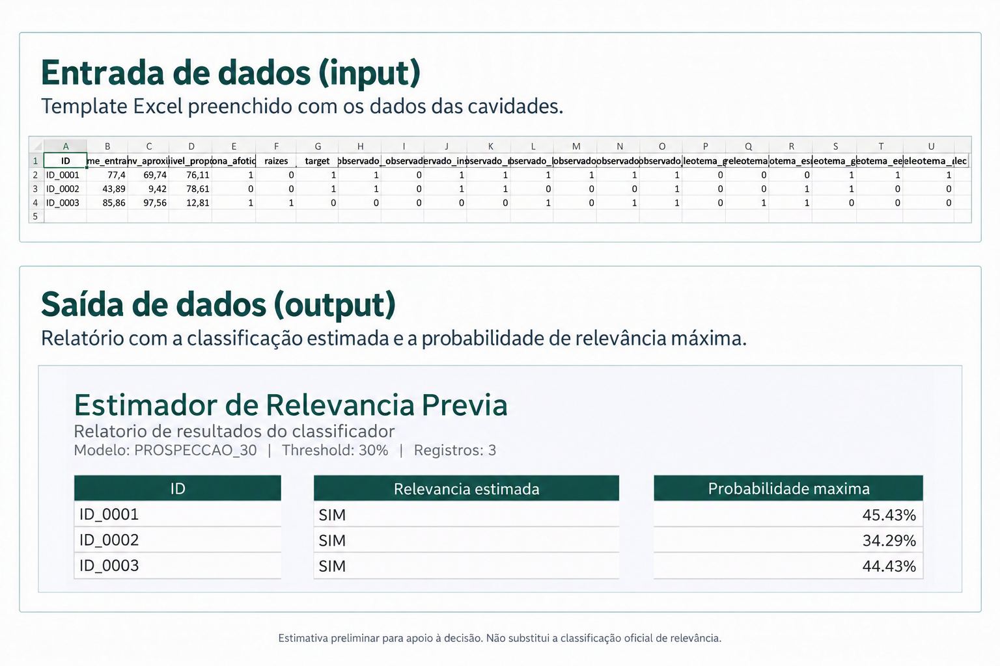

# Estimador de Relevância Prévia de Cavidades

> Modelos de Machine Learning (Random Forest) que estimam, de forma automática e em lote, a probabilidade de uma cavidade natural ser classificada como de **relevância máxima**, usando dados das etapas iniciais dos estudos espeleológicos: **prospecção** e **topografia**.


---

## 📌 Sumário

- [Contexto](#-contexto)
- [O que a solução faz](#-o-que-a-solução-faz)
- [Modelos](#-modelos)
- [Dados utilizados](#-dados-utilizados)
- [Arquitetura](#-arquitetura)
- [Interface](#-interface)
- [Estrutura do repositório](#-estrutura-do-repositório)
- [Como executar](#-como-executar)
- [Limitações e uso responsável](#-limitações-e-uso-responsável)
- [Equipe](#-equipe)

---

## 🧭 Contexto

A relevância das cavidades (baixa, média, alta ou máxima) segue a legislação vigente e depende de atributos geológicos, biológicos, hidrológicos, arqueológicos, paleontológicos e histórico-culturais. Cavidades de relevância máxima restringem o planejamento e a viabilidade de empreendimentos minerários, e a classificação final pode levar pelo menos 18 meses de estudos, período em que a equipe de engenharia planeja com incerteza.

Para a equipe técnica de espeleologia, fazer uma avaliação preliminar manual, cavidade por cavidade, é trabalhoso e envolve muitas variáveis ao mesmo tempo.

**Objetivo:** criar um modelo preditivo capaz de estimar uma **pré-classificação de relevância** usando apenas dados iniciais de prospecção e espeleotopografia, para:

- direcionar melhor os esforços de campo;
- apoiar o planejamento dos estudos posteriores;
- otimizar tempo e recursos dos projetos.

---

## ⚙️ O que a solução faz

1. O usuário escolhe o modelo e o threshold.
2. Baixa o template Excel correspondente ao modelo.
3. Preenche a planilha seguindo o dicionário de dados.
4. Envia o arquivo e o estimador processa **todas as cavidades em lote**.
5. O resultado é entregue em uma nova planilha, com a probabilidade estimada e a classificação de cada cavidade.

Nos testes dos quatro modelos, o processamento levou cerca de **11 a 15 segundos**.

---

## 🤖 Modelos

Os quatro modelos usam **Random Forest** e estão publicados no SAS Model Manager.

| Modelo | Dados de entrada | Variáveis | Thresholds disponíveis |
|---|---|---|---|
| `prosp` | Prospecção | 48 | 30% e 35% |
| `prosp_topo` | Prospecção + topografia | 52 | 30% e 35% |

**Threshold:** é o corte de probabilidade a partir do qual a cavidade é classificada como de relevância máxima. Quanto menor o threshold, mais cavidades máximas o modelo capta, mas também aumentam os falsos positivos e o volume de cavidades encaminhadas para avaliação.

---

## 🗂️ Dados utilizados

Os modelos foram treinados com dados históricos do **Espeleo Vale**. A base original tinha **7.158 registros e 257 colunas**, que passaram por tratamento, filtros e seleção de variáveis. A seleção combinou critérios estatísticos com a validação da equipe de espeleologia.

### Prospecção (48 variáveis)
Dados registrados por observação na primeira ida a campo:

| Grupo | Exemplo |
|---|---|
| Fauna | presença de animais e vestígios |
| Espeleotemas | formações minerais |
| Hidrologia | água, lagos e drenagens |
| Litotipo | tipo de rocha |
| Dificuldades e feições internas | ex.: blocos instáveis |
| Arqueologia e paleontologia | vestígios culturais e fósseis |
| Ambiente, guano e tipo de cavidade | contexto da cavidade |
| Dimensões aproximadas | estimativas de prospecção |

### Prospecção + Topografia (52 variáveis)
As 48 variáveis da prospecção mais quatro medições topográficas:

- Projeção horizontal
- Desnível
- Área
- Volume

> O dicionário completo de dados, com tipos, valores aceitos e correspondência com o Espeleo Vale, está disponível no **Manual de instruções** da interface.

---

## 🏗️ Arquitetura

```text
┌──────────────────────┐    ┌───────────────────────┐    ┌────────────────────────┐
│  Desenvolvimento     │    │  Publicação           │    │  Uso                   │
│  (Python)            │ →  │  (SAS Viya)           │ →  │  (Interface web)       │
│                      │    │                       │    │                        │
│ • Preparação da base │    │ • SAS Model Manager   │    │ • Template Excel       │
│ • Seleção de         │    │ • Código de score     │    │ • Processamento em lote│
│   variáveis          │    │   em Python           │    │ • Planilha de resultado│
│ • Treino e validação │    │ • SAS Job Execution   │    │ • Manual e dicionário  │
└──────────────────────┘    └───────────────────────┘    └────────────────────────┘
```

- **Modelagem:** desenvolvida e treinada em Python, fora do SAS Viya.
- **Implantação:** o SAS Viya foi adotado **por exigência do cliente**. Os modelos foram publicados no SAS Model Manager, e a interface roda como programa do SAS Job Execution.
- **Portabilidade:** como a metodologia foi desenvolvida em Python, ela não depende do SAS Viya e pode ser incorporada a outros ambientes, como o ambiente Arcadis.

---

## 🖥️ Interface


| Tela inicial | Estimar relevância |
|---|---|
|  |  |

<strong class="___1qwroh2 fl43uef f19n0e5" data-lexical-text="true">**Entrada e saída de dados:**</strong> exemplo do arquivo de entrada e do resultado gerado pela solução.
<br><br>

<br><br>
<strong class="___1qwroh2 fl43uef f19n0e5" data-lexical-text="true">**Manual de instruções:**</strong> fluxo de uso, dicionário de dados e explicação dos modelos.
<br><br>

<br><br>
<strong class="___1qwroh2 fl43uef f19n0e5" data-lexical-text="true">---</strong>

---

## 📁 Estrutura do repositório

```text
ML-Relev-ncia-de-Cavernas/
├── sas_front/                     # Interface web (HTML/CSS/JS) e exportação dos modelos para o SAS
├── src/
│   └── ml_relev_ncia_de_cavernas/ # Código Python: preparação dos dados, treino, testes e avaliação
├── docs/
│   └── img/                       # Prints da interface usados neste README
├── .python-version                # Versão do Python do projeto
├── pyproject.toml                 # Dependências e configuração do projeto
├── uv.lock                        # Lock das dependências (uv)
└── README.md
```

---

## ▶️ Como executar

O projeto usa o gerenciador [uv](https://docs.astral.sh/uv/).

```bash
# 1. Clonar o repositório
git clone <URL-do-repositório>
cd ML-Relev-ncia-de-Cavernas

# 2. Instalar as dependências
uv sync

# 3. Abrir os notebooks de modelagem
uv run jupyter lab
```

> Os dados do Espeleo Vale pertencem ao cliente e devem ser obtidos pelos canais autorizados.

---

## ⚠️ Limitações e uso responsável

- O estimador é uma **ferramenta de apoio à decisão**. Ele **não substitui** os estudos técnicos nem a classificação oficial de relevância prevista na legislação.
- Os resultados se referem às bases de validação analisadas. O desempenho deve ser acompanhado ao aplicar o modelo em novas localidades.
- O resultado depende da qualidade do preenchimento do template. Siga o dicionário de dados, mantenha os nomes exatos das colunas e não preencha a coluna `target`.

---

## 👥 Equipe

Desenvolvido pela equipe de **Inovação Digital da Arcadis**, em parceria com a equipe de Espeleologia, para o **Banco de Dados Ambientais (BDA) da Vale**.

| Contato | |
|---|---|
| _[@Karina Silva](mailto:karina.santos@arcadis.com)_ |
| _[@Gabriel So](mailto:GABRIEL.SO@arcadis.com)_ |
| _[@Danielle Blazys](mailto:danielle.blazys@arcadis.com)_ |

---

<p align="right">Powered by <b>Arcadis</b></p>
