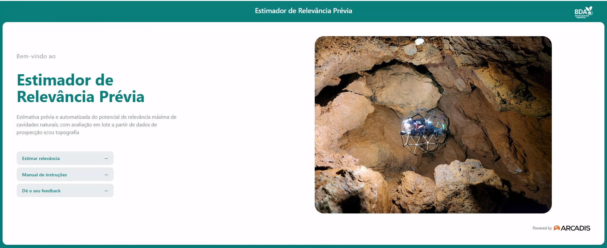
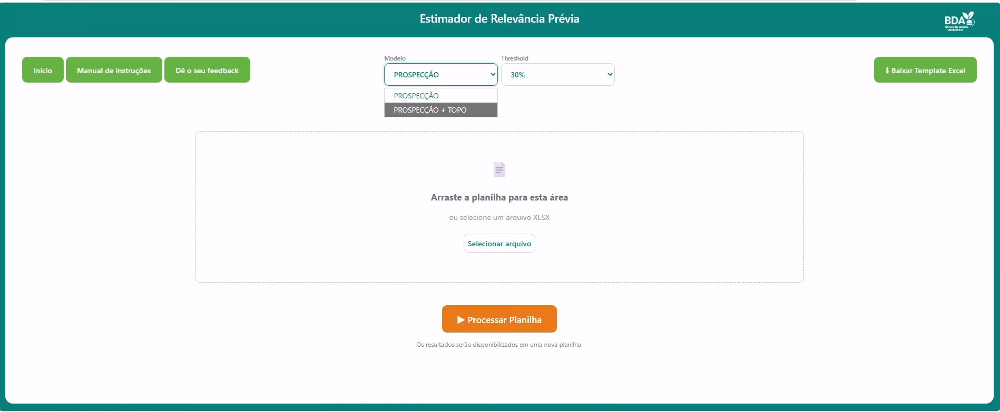
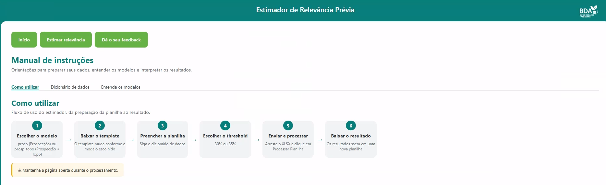

# Estimador de Relevância Prévia de Cavidades

> Modelos de Machine Learning (Random Forest) que estimam, de forma automática e em lote, a probabilidade de uma cavidade natural ser classificada como de **relevância máxima**, usando dados das etapas iniciais dos estudos espeleológicos: **prospecção** e **topografia**.




---

## 📌 Sumário

- [Contexto](#-contexto)
- [O que a solução faz](#-o-que-a-solução-faz)
- [Dados utilizados](#-dados-utilizados)
- [Modelos](#-modelos)
- [Arquitetura](#-arquitetura)
- [Interface](#-interface)
- [Estrutura do repositório](#-estrutura-do-repositório)
- [Como executar](#-como-executar)
- [Limitações e uso responsável](#-limitações-e-uso-responsável)
- [Mais informações](#-mais-informações)
- [Equipe](#-equipe)

---

## 🧭 Contexto

A relevância das cavidades (baixa, média, alta ou máxima) segue a IN MMA nº 2/2017 e o Decreto nº 99.556/1990, e depende de atributos geológicos, biológicos, hidrológicos, arqueológicos, paleontológicos e histórico-culturais. Cavidades de relevância máxima podem restringir a viabilidade de empreendimentos minerários, e a classificação final pode exigir ao menos 18 meses de estudos, período em que o planejamento ocorre sob incerteza.
<br><br>
Para especialistas em espeleologia, a avaliação preliminar manual, cavidade por cavidade, é trabalhosa e envolve muitas variáveis simultâneas.

**Objetivo:** Criar um modelo preditivo capaz de estimar uma **pré-classificação de relevância** usando apenas dados iniciais de prospecção e espeleotopografia, para:

- Direcionar melhor os esforços de campo;
- Apoiar o planejamento dos estudos posteriores;
- Otimizar tempo e recursos dos projetos.

---

## ⚙️ O que a solução faz

Por meio de modelos preditivos, a solução usa dados das etapas iniciais dos estudos (prospecção e espeleotopografia) para estimar previamente a probabilidade de uma cavidade ser classificada como de relevância máxima. A estimativa apoia o planejamento e não substitui a classificação oficial. Para isso, segue-se as etapas:

1. Escolha o modelo (dados de prospecçãao e/ou topografia) e o corte (threshold de 30% ou 35%).
2. Baixe o template Excel correspondente ao modelo.
3. Preencha a planilha seguindo o dicionário de dados.
4. Envie o arquivo: o estimador processa **todas as cavidades em lote**.
5. Receba uma nova planilha ou PDF com a probabilidade estimada e a classificação de cada cavidade.

Nos testes dos quatro modelos, o processamento levou cerca de **10 a 20 segundos**.

---
## 🗂️ Dados utilizados

Os modelos foram treinados com dados históricos do **Espeleo Vale**. A base original tinha **7.158 registros e 257 colunas**, que passaram por tratamento, filtros e seleção de variáveis. A seleção combinou critérios estatísticos com a validação da equipe de espeleologia.

### Prospecção (48 variáveis)

Dados registrados por observação na primeira ida a campo.

### Prospecção + Topografia (52 variáveis)

As 48 variáveis da prospecção mais quatro medições topográficas:

- Projeção horizontal
- Desnível
- Área
- Volume

### Dicionário de dados

O template tem **50 colunas** para os modelos de prospecção (2 de identificação + 48 variáveis) e **54 colunas** para os modelos com topografia (+ 4 variáveis topográficas). Os cabeçalhos devem ser mantidos **exatamente** como no template, inclusive os truncados.

| Grupo | Variáveis | Tipo | Valores |
|---|---|---|---|
| Identificação (`ID`, `nome_entrada`) | 2 | Texto / inteiro | Código único (ex.: SRA_0002) / nº da entrada |
| Dimensões (prospecção) | 2 | Decimal | Metros |
| Ambiente | 2 | Binário | 0 = não · 1 = sim |
| Fauna observada | 8 | Binário | 0 = não · 1 = sim |
| Espeleotemas | 7 | Binário | 0 = não · 1 = sim |
| Hidrologia | 6 | Binário | 0 = não · 1 = sim |
| Dificuldades internas | 5 | Binário | 0 = não · 1 = sim |
| Feições internas | 4 | Binário | 0 = não · 1 = sim |
| Arqueologia e paleontologia | 4 | Binário | 0 = não · 1 = sim |
| Litotipo | 5 | Binário | 0 = não · 1 = sim |
| Guano | 2 | Binário | 0 = não · 1 = sim |
| Tipo de cavidade | 3 | Binário | 0 = não · 1 = sim |
| Dimensões (topografia) | 4 | Decimal | Projeção horizontal, desnível, área, volume |

> > O dicionário completo (descrição de cada coluna, tipos, valores aceitos e regras de preenchimento) está em [`docs/dicionário_dados.xlsx`](docs/dicionario_dados.xlsx) e também na aba **Manual de instruções** da interface.

---

## 🤖 Modelos

Com base nesses dados, foram desenvolvidos quatro modelos **Random Forest** (dois conjuntos de variáveis, cada um com dois thresholds), publicados no SAS Model Manager.

| Modelo | Dados de entrada | Variáveis | Thresholds disponíveis |
|---|---|---|---|
| `prosp` | Prospecção | 48 | 30% e 35% |
| `prosp_topo` | Prospecção + topografia | 52 | 30% e 35% |

**Threshold:** é o corte de probabilidade a partir do qual a cavidade é classificada como de relevância máxima. Quanto menor o threshold, mais cavidades máximas o modelo capta, mas também aumentam os falsos positivos e o volume de cavidades encaminhadas para avaliação.
A escolha do algoritmo (Random Forest) e dos thresholds foi desenvolvida em conjunto com os especialistas em espeleologia.

---

## 🏗️ Arquitetura

```text
┌──────────────────────┐    ┌───────────────────────┐    ┌────────────────────────┐
│  Desenvolvimento     │    │  Publicação           │    │  Uso                   │
│  (Python)            │ →  │  (SAS Viya)           │ →  │  (Interface web)       │
│                      │    │                       │    │                        │
│ • Preparação da base │    │ • SAS Model Manager   │    │ • Template Excel       │
│ • Seleção de         │    │ • Código de score     │    │ • Processamento em lote│
│   variáveis          │    │   em Python           │    │ • Planilha de resultado│
│ • Treino e validação │    │ • SAS Job Execution   │    │ • Manual e dicionário  │
└──────────────────────┘    └───────────────────────┘    └────────────────────────┘
```

- **Modelagem:** desenvolvida e treinada em Python, fora do SAS Viya.
- **Implantação:** o SAS Viya foi adotado **por exigência do cliente**. Os modelos foram publicados no SAS Model Manager, e a interface roda como programa do SAS Job Execution.
- **Portabilidade:** como a metodologia foi desenvolvida em Python, ela não depende do SAS Viya e pode ser incorporada a outros ambientes, como o ambiente Arcadis.

---

## 🖥️ Interface


| Tela inicial | Estimar relevância |
|---|---|
|  |  |

<strong class="___1qwroh2 fl43uef f19n0e5" data-lexical-text="true">**Entrada e saída de dados:**</strong> exemplo do arquivo de entrada e do resultado gerado pela solução.
<br><br>

<br><br>
<strong class="___1qwroh2 fl43uef f19n0e5" data-lexical-text="true">**Manual de instruções:**</strong> fluxo de uso, dicionário de dados e explicação dos modelos.
<br><br>

<br><br>
<strong class="___1qwroh2 fl43uef f19n0e5" data-lexical-text="true">---</strong>


## 📁 Estrutura do repositório

```text
ML-Relev-ncia-de-Cavernas/
├── sas_front/                     # Interface web (HTML/CSS/JS) e exportação dos modelos para o SAS
├── src/
│   └── ml_relev_ncia_de_cavernas/ # Código Python: preparação dos dados, treino, testes e avaliação
├── docs/
│   └── img/                       # Prints da interface usados neste README
├── .python-version                # Versão do Python do projeto
├── pyproject.toml                 # Dependências e configuração do projeto
├── uv.lock                        # Lock das dependências (uv)
└── README.md
```

---

## ▶️ Como executar

O projeto usa o gerenciador [uv](https://docs.astral.sh/uv/).

```bash
# 1. Clonar o repositório
git clone <URL-do-repositório>
cd ML-Relev-ncia-de-Cavernas

# 2. Instalar as dependências
uv sync

# 3. Abrir os notebooks de modelagem
uv run jupyter lab
```

> Os dados do Espeleo Vale pertencem ao cliente e devem ser obtidos pelos canais autorizados.

---

## ⚠️ Limitações e uso responsável

- O estimador é uma **ferramenta de apoio à decisão**. Ele **não substitui** os estudos técnicos nem a classificação oficial de relevância prevista na legislação.
- Os resultados se referem às bases de validação analisadas. O desempenho deve ser acompanhado ao aplicar o modelo em novas localidades.
- O resultado depende da qualidade do preenchimento do template. Siga o dicionário de dados, mantenha os nomes exatos das colunas e não preencha a coluna `target`.
---

## 📚 Mais informações

A documentação final da solução reúne o contexto, os dados, a modelagem, a arquitetura e o guia técnico de operação e manutenção:

📄 [Documentação final – Estimador de Relevância Prévia](docs/documentacao_estimador_relevancia_previa.docx)

| Parte | Conteúdo |
|---|---|
| **I – Visão geral** | Contexto e problema, dados e preparação da base, modelagem e resultados, arquitetura e uso da solução |
| **II – Guia técnico** | Inventário de componentes, acessos, retreinamento, publicação no SAS Viya, manutenção da interface e problemas conhecidos |
| **III – Governança** | Limitações, recomendações, contatos e histórico do projeto |

---

## 👥 Equipe

Desenvolvido pela equipe de **Inovação Digital da Arcadis**, em parceria com a equipe de Espeleologia da Vale.

| Contato | |
|---|---|
[@Karina Silva](mailto:karina.santos@arcadis.com)
[@Gabriel So](mailto:GABRIEL.SO@arcadis.com)
[@Danielle Blazys](mailto:danielle.blazys@arcadis.com)

---

<p align="right">Powered by <b>Arcadis</b></p>
